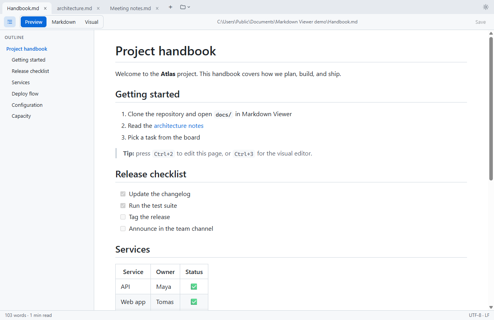

# Markdown Viewer

A fast Windows desktop app for reading and editing Markdown files: tabs, a live preview, and two ways to edit, either the Markdown source or a visual editor.



## Download

Get the latest version from the **[Releases page](https://github.com/aljazmernik/markdown-viewer/releases)**:

- **`MarkdownViewer-x.y.z-setup.msi`** (recommended): installer. It includes everything it needs, installs for your user only (no admin rights), adds a Start Menu shortcut, updates itself, and can be removed from *Settings → Apps*.
- **`MarkdownViewer-x.y.z.exe`**: small portable file. It needs the [.NET 9 Desktop Runtime](https://dotnet.microsoft.com/download/dotnet/9.0) (x64); if that's missing, Windows offers to download it the first time.

Each file has a `.sha256` checksum next to it on the release page.

**Requirements:** Windows 10 or 11 (64-bit) and the Microsoft Edge WebView2 Runtime, which comes with Windows 11 and current Windows 10.

> If Windows shows "Windows protected your PC", the release isn't code-signed yet. Click **More info → Run anyway**.

## Features

**Viewing**
- GitHub-style rendering: tables, task lists, footnotes, emoji, and syntax-highlighted code
- Mermaid diagrams and KaTeX math
- Works fully offline, with every library bundled inside the exe
- Live reload: the preview updates when the file changes on disk and keeps your scroll position
- Relative images and links work; links to other `.md` files open in a new tab

**Editing**
- **Markdown** mode: source editor with a side-by-side preview. It keeps your exact text.
- **Visual** mode: WYSIWYG editing, like a word processor
- New file, Save, Save As; warns before closing unsaved work
- If a file changes outside the app while you have unsaved edits, you can choose which version to keep

**Workspace**
- Tabs, all in one window. Opening another file from Explorer adds a tab instead of a new window.
- Your open tabs are restored the next time you start the app
- Recent files, reopen a closed tab, and a right-click menu on tabs
- Outline sidebar that follows the section you're reading
- Status bar with word count, reading time, cursor position and line endings
- Light, dark, or follow the Windows theme

## Keyboard shortcuts

| Shortcut | Action |
|---|---|
| Ctrl+N / Ctrl+O | New file / open files |
| Ctrl+S / Ctrl+Shift+S | Save / save as |
| Ctrl+1 / 2 / 3 | Preview / Markdown / Visual mode |
| Ctrl+E | Switch between preview and the last edit mode |
| Ctrl+Shift+O | Show or hide the outline |
| Ctrl+Tab / Ctrl+Shift+Tab | Next / previous tab |
| Ctrl+W | Close tab |
| Ctrl+Shift+T | Reopen closed tab |
| F5 | Reload file from disk |
| Ctrl+F | Find in page |
| Ctrl + / Ctrl − | Zoom |

## Updates

A few seconds after starting (at most once a day), the app checks this repository's latest GitHub release. If there's a newer version, a bar appears under the tabs:

- **Install update** (installed with the MSI): downloads the new installer, checks it against the release's SHA-256 checksum (and, for signed builds, that it's signed by the same publisher), asks about unsaved files, updates, and restarts with your tabs restored.
- **Download** (portable exe): opens the release page.
- **Skip this version** hides it until the next release.

You can also check any time with the folder button → **Check for updates**.

## Open `.md` files with Markdown Viewer

To make it the default app for `.md` and `.markdown` files, with its own document icon in Explorer, run once:

```bat
"%LOCALAPPDATA%\Programs\Markdown Viewer\MarkdownViewer.exe" --register
```

(For the portable exe, use its own path.) This only affects your user account. `--unregister` restores the previous default.

## Building from source

Requires the [.NET 9 SDK](https://dotnet.microsoft.com/download/dotnet/9.0).

```powershell
dotnet publish -c Release -o publish      # -> publish\MarkdownViewer.exe
```

### Releasing

Releases are built and published by GitHub Actions ([`.github/workflows/release.yml`](.github/workflows/release.yml)):

1. Set the new version in `MarkdownViewer.csproj` (`<Version>1.3.0</Version>`).
2. Optionally write the release notes in `release-notes/v1.3.0.md`; otherwise GitHub generates them from the commits.
3. Commit, then push a tag:
   ```powershell
   git tag v1.3.0
   git push origin main v1.3.0
   ```

The workflow builds the portable exe, the self-contained installer and their `.sha256` checksums, and publishes them as the GitHub Release for that tag. Every push to `main` also runs the build (without publishing), and the files can be downloaded from the run's artifacts.

To build the same files locally into `releases\`:

```powershell
.\tools\release.ps1          # bump patch version (1.2.0 -> 1.2.1) and build exe + installer
.\tools\release.ps1 minor    # 1.2.0 -> 1.3.0
.\tools\release.ps1 major    # 1.2.0 -> 2.0.0
.\tools\build-installer.ps1  # only rebuild the installer for the current version
```

The installer is built with [WiX Toolset](https://wixtoolset.org/) 5, which is pinned as a local .NET tool (`dotnet tool restore` installs it). The in-app updater downloads the release asset ending in `-setup.msi` and requires its checksum (`-setup.msi.sha256`, or GitHub's asset digest).

### Code signing

Signing removes the "Windows protected your PC" warning and lets the updater require that updates come from the same publisher. Once you have a code-signing certificate (`.pfx`), add two repository secrets under *Settings → Secrets and variables → Actions*:

- `CODESIGN_PFX_BASE64`: the certificate file, base64-encoded (`[Convert]::ToBase64String([IO.File]::ReadAllBytes('cert.pfx'))`)
- `CODESIGN_PFX_PASSWORD`: its password

The workflow then signs the exe and the installer. Locally, set `CODESIGN_PFX_PATH` and `CODESIGN_PFX_PASSWORD` before running `tools\release.ps1`.

### Publishing to winget

After a release is published, generate the [winget](https://learn.microsoft.com/windows/package-manager/) manifests from its installer (download it into `releases\` first if GitHub Actions built it):

```powershell
.\tools\winget-manifest.ps1 1.3.0     # -> releases\winget\1.3.0\
```

Then submit them as a pull request to [microsoft/winget-pkgs](https://github.com/microsoft/winget-pkgs) under `manifests/a/AljazMernik/MarkdownViewer/1.3.0/`. Once merged, anyone can run `winget install AljazMernik.MarkdownViewer`.

### Project layout

| Path | What it is |
|---|---|
| `Program.cs` | Entry point, single-instance handling, `--register` |
| `MainForm.cs` | Window, tabs, file handling, and serving the UI to WebView2 |
| `Doc.cs` | One open file: reading, saving, watching for changes |
| `FileAssociation.cs` | Per-user `.md` file association |
| `Updater.cs`, `Authenticode.cs` | Update check against GitHub Releases; download, verify and install |
| `web/` | The UI: `shell.js` (tab bar) and `app.js` (document, editor, outline) |
| `lib/` | Bundled third-party libraries (see below) |
| `installer/Package.wxs` | MSI installer definition |
| `tools/` | Release, installer, signing, winget and icon scripts |
| `.github/workflows/` | Automated release builds |

## Built with

- [.NET 9](https://dotnet.microsoft.com/) WinForms + [WebView2](https://developer.microsoft.com/microsoft-edge/webview2/)
- [Markdig](https://github.com/xoofx/markdig): Markdown rendering
- [Toast UI Editor](https://github.com/nhn/tui.editor): Markdown and visual editing
- [highlight.js](https://highlightjs.org/), [Mermaid](https://mermaid.js.org/), [KaTeX](https://katex.org/)

The licenses of these components are in [THIRD-PARTY-NOTICES.md](THIRD-PARTY-NOTICES.md).

## License

[MIT](LICENSE) © Aljaz Mernik
