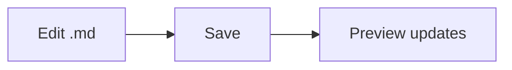

# Markdown Viewer sample

Some **bold**, *italic*, ~~strike~~, `inline code` and a [link](https://github.com) :smile:

## Task list

- [x] Render GitHub-flavored Markdown
- [x] Live reload on save
- [ ] Your next idea

## Table

| Feature     | Status |
|-------------|:------:|
| Tables      |   ✅   |
| Code blocks |   ✅   |

## Code

```csharp
static void Main() => Console.WriteLine("Hello, Markdown!");
```

> Blockquote with a footnote.[^1]

## Diagram



## Math

$$
E = mc^2
$$

[^1]: Footnotes work too.
